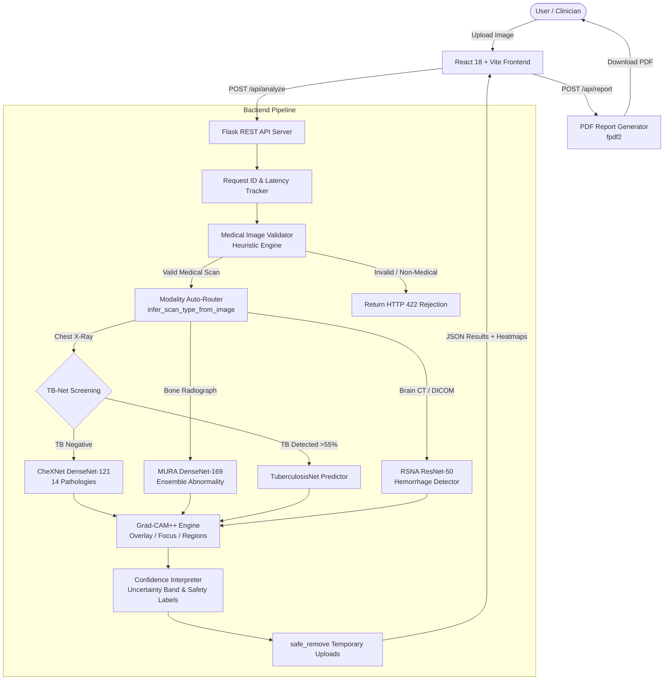

# MediScan AI — Early Medical Radiograph Disease Detection System

[](https://github.com/vishalsahanipvppcoe/clg/actions/workflows/backend-ci.yml)
[](https://vitejs.dev/)
[](https://flask.palletsprojects.com/)
[](https://pytorch.org/)

An intelligent clinical decision-support platform designed to analyze medical radiographs (Chest X-rays, Musculoskeletal radiographs, and CT scans). MediScan AI integrates computer vision input validation, automatic scan-type routing, deep neural network inference, research-grade Grad-CAM++ visual explainability, calibrated clinical confidence interpretation, and downloadable PDF diagnostic summaries.

---

## Table of Contents

- [Project Overview](#project-overview)
- [Key Features](#key-features)
- [Technology Stack](#technology-stack)
- [Project Architecture](#project-architecture)
- [Project Folder Structure](#project-folder-structure)
- [Prerequisites](#prerequisites)
- [Installation and Setup](#installation-and-setup)
- [How to Run the Project](#how-to-run-the-project)
- [How to Use the Application](#how-to-use-the-application)
- [API Documentation](#api-documentation)
- [Model and Algorithm Details](#model-and-algorithm-details)
- [Testing and Verification](#testing-and-verification)
- [Configuration and Security](#configuration-and-security)
- [Known Limitations](#known-limitations)
- [Troubleshooting](#troubleshooting)
- [Future Improvements](#future-improvements)
- [Contributing](#contributing)
- [License](#license)
- [Medical Disclaimer](#medical-disclaimer)

---

## Project Overview

### The Problem
Interpreting medical radiographs rapidly and accurately is challenging, especially in emergency scenarios or resource-constrained clinics where specialized radiologists are not always immediately available. Misidentifying pathology or delay in triaging critical conditions (such as Pneumothorax, Pneumonia, or Bone Fractures) can impact patient outcomes.

### The Solution
**MediScan AI** acts as a computer-aided screening assistant:
1. **Validates Uploads**: Uses a computer vision gatekeeper to reject invalid or non-medical images before deep learning inference.
2. **Auto-Routes Scans**: Heuristically determines whether an uploaded scan is a chest radiograph, bone radiograph, or CT scan.
3. **Screens for Pathologies**: Executes specialized neural network models (e.g., DenseNet-121 CheXNet for 14 chest diseases, MURA for fractures, TB-Net for Tuberculosis).
4. **Explains Predictions**: Highlights exact pathological areas using Grad-CAM++ heatmaps across three visual modes (Overlay, Focus, Regions).
5. **Provides Clinical Framing**: Replaces raw probability scores with risk likelihood labels and uncertainty bands, generating structured, downloadable PDF reports.

---

## Key Features

### 1. Multi-Modality Intelligent Scan Analysis
- **Automatic Modality Routing**: Analyzes bilateral lung field symmetry, horizontal rib structures, bone edge density, and DICOM metadata to dynamically route scans to the most appropriate AI model.
- **Manual Override**: Allows clinicians and researchers to target a specific model (`chexnet`, `mura`, `tuberculosis`, `rsna`) or scan type.

### 2. Medical Image Validation Gatekeeper
- **Statistical Gating Engine**: Prevents non-medical uploads (such as selfies, memes, landscape photos, or pets) from reaching the inference models using 7 calibrated image metrics (grayscale dominance, contrast range, exposure bounds, resolution).
- **Graceful Error Feedback**: Returns structured explanations with status code `422 Unprocessable Entity` when an invalid image is uploaded.

### 3. Multi-Disease Classification
- **CheXNet (Chest X-Ray)**: Evaluates 14 distinct chest conditions: *Atelectasis, Cardiomegaly, Effusion, Infiltration, Mass, Nodule, Pneumonia, Pneumothorax, Consolidation, Edema, Emphysema, Fibrosis, Pleural Thickening, and Hernia*.
- **MURA (Musculoskeletal Radiographs)**: Predicts abnormality and structural fractures across extremities (wrist, elbow, shoulder, hand) via an ensemble of DenseNet-169 features and edge/texture heuristics.
- **Tuberculosis Screening**: High-sensitivity Tuberculosis screening pipeline with attention mechanisms and OpenCV symmetry fallback.

### 4. Explainable AI (Grad-CAM++)
- Generates high-resolution class activation maps showing exactly where the neural network detected pathological patterns.
- **Three Visualization Modes**:
  1. **Overlay**: Smooth Gaussian-blended heatmap preserving background tissue details.
  2. **Focus**: Soft-thresholded isolation of pathological regions with a dimmed background.
  3. **Regions**: Distinct bounding boxes enclosing the highest activation foci.

### 5. Clinical Decision-Support & Confidence Framing
- **No Direct Diagnosis Framing**: Uses cautious, safe clinical phrasing (e.g., *"AI Suggests Possible Finding"* rather than definitive diagnoses).
- **Confidence Likelihood & Uncertainty Band**: Incorporates a calibrated uncertainty range ($\pm 5\text{--}10\%$) reflecting real-world model variance.

### 6. PDF Clinical Summary Report
- Instant downloadable PDF summary generated via `fpdf2` containing scan metadata, request tracking IDs, classified disease conditions, severity indicators, and institutional disclaimers.

---

## Technology Stack

### Frontend
- **Framework:** React 18 with TypeScript
- **Build Tool:** Vite 5.4
- **Styling:** Tailwind CSS 3.4
- **UI Components:** Radix UI primitives, Lucide React icons, Sonner notifications
- **Data Visualization:** Recharts

### Backend
- **Framework:** Python Flask 2.3+ & Werkzeug
- **Concurrency & Serving:** Gunicorn, ThreadPoolExecutor, Flask-CORS
- **Deep Learning:** PyTorch (`torch`, `torchvision`)
- **Computer Vision & Image Processing:** OpenCV (`opencv-python`), Pillow (`PIL`), SciPy
- **Medical Imaging Formats:** PyDICOM (`pydicom`)
- **PDF Generation:** FPDF2 (`fpdf2`)
- **Testing:** Pytest

### Infrastructure & Deployment
- **Backend Deployment:** Render (`render.yaml` with Python 3.11 runtime)
- **Frontend Deployment:** Vercel (`vercel.json` with client-side rewrites)
- **Continuous Integration:** GitHub Actions (`.github/workflows/backend-ci.yml`)

---

## Project Architecture



---

## Project Folder Structure

```
shetty_project/
├── .github/
│   └── workflows/
│       └── backend-ci.yml        # GitHub Actions CI for backend testing
├── backend/
│   ├── app.py                    # Flask API entry point & routing pipeline
│   ├── report_generator.py       # PDF diagnostic report generator (FPDF2)
│   ├── requirements.txt          # Python dependencies
│   ├── pytest.ini                # Pytest configuration
│   ├── datasets/                 # Model checkpoints & weights
│   │   └── CheXNet/
│   │       ├── model.pth.tar     # Trained CheXNet model weights (84.1 MB)
│   │       ├── model.py          # CheXNet model definition
│   │       └── finetune_pneumonia.py
│   ├── models/                   # Inference predictors & CV modules
│   │   ├── chexnet_inference.py  # CheXNet 14-disease inference
│   │   ├── mura_inference.py     # MURA bone radiograph inference
│   │   ├── tuberculosis_inference.py # TB screening inference
│   │   ├── rsna_inference.py     # RSNA brain CT inference
│   │   ├── unet_inference.py     # UNet segmentation module
│   │   ├── gradcam.py            # Grad-CAM++ explainability engine
│   │   ├── medical_validator.py  # Non-medical image rejection gatekeeper
│   │   └── confidence_interpreter.py # Clinical likelihood & uncertainty framing
│   ├── tests/                    # Pytest backend test suite
│   │   ├── conftest.py           # Shared fixtures & synthetic image generators
│   │   ├── test_analyze_inference.py
│   │   ├── test_analyze_validation.py
│   │   ├── test_health_and_models.py
│   │   ├── test_medical_validation.py
│   │   ├── test_predict_endpoints.py
│   │   ├── test_report_endpoint.py
│   │   └── test_request_tracking.py
│   └── uploads/                  # Ephemeral upload folder (.gitkeep)
├── frontend/
│   ├── index.html                # Single-page application template
│   ├── package.json              # Node.js dependencies and scripts
│   ├── vite.config.ts            # Vite bundler configuration
│   ├── tailwind.config.ts        # Tailwind CSS design system configuration
│   ├── vercel.json               # Vercel deployment configuration
│   └── src/
│       ├── main.tsx              # React entry point
│       ├── App.tsx               # Root application component
│       ├── config.ts             # API base URL & endpoints configuration
│       ├── components/
│       │   ├── AnalysisSection.tsx # Main analysis coordinator
│       │   ├── AnalysisResults.tsx # Results dashboard & heatmap switcher
│       │   ├── ImageUpload.tsx     # File upload dropzone & pre-checks
│       │   ├── Header.tsx          # Navigation header
│       │   ├── Footer.tsx          # Application footer
│       │   └── ui/                 # Radix UI design components
│       └── pages/
│           ├── Index.tsx           # Home landing page
│           └── NotFound.tsx        # 404 handler
├── .gitignore                    # Git exclusion rules
├── render.yaml                   # Render.com cloud deployment blueprint
├── CODEBASE_AUDIT.md             # Formal codebase verification & QA audit report
└── README.md                     # Project documentation
```

---

## Prerequisites

Before running the application locally, ensure you have the following installed:

- **Node.js**: Version `18.x` or higher (verified on Node `v24.20.0`)
- **npm**: Version `9.x` or higher
- **Python**: Version `3.10` or `3.11` (Python 3.11 is recommended for PyTorch compatibility)
- **Git**: Installed and available in your terminal

---

## Installation and Setup

### 1. Clone the Repository
```bash
git clone https://github.com/vishalsahanipvppcoe/clg.git
cd clg
```

### 2. Set Up the Backend
Navigate to the `backend/` directory, create a Python virtual environment, and install dependencies:

```bash
cd backend

# Create a virtual environment
python -m venv venv

# Activate virtual environment
# Windows (PowerShell):
.\venv\Scripts\Activate.ps1
# Windows (Command Prompt):
.\venv\Scripts\activate.bat
# Linux / macOS:
source venv/bin/activate

# Install required packages
pip install --upgrade pip
pip install -r requirements.txt
```

> **Note on PyTorch:** If you do not have an NVIDIA GPU, install the CPU-only PyTorch wheels for faster setup:
> ```bash
> pip install --extra-index-url https://download.pytorch.org/whl/cpu torch torchvision
> ```

### 3. Set Up the Frontend
Open a separate terminal, navigate to the `frontend/` directory, and install the Node packages:

```bash
cd frontend
npm install
```

---

## How to Run the Project

### 1. Launch the Backend Server
From the activated virtual environment inside `backend/`:
```bash
python app.py
```
- **Backend URL:** `http://localhost:5000`
- **Health Check:** `http://localhost:5000/health`
- **Models Endpoint:** `http://localhost:5000/models`

### 2. Launch the Frontend Development Server
In your frontend terminal:
```bash
npm run dev
```
- **Frontend URL:** `http://localhost:5173`

Open your web browser and navigate to `http://localhost:5173` to interact with MediScan AI.

---

## How to Use the Application

1. **Upload a Scan:** Drag and drop an X-ray or CT image (PNG, JPG, JPEG, or DICOM `.dcm`) into the upload dropzone.
2. **Automated Inspection:**
   - The application checks that the file size is under 15 MB.
   - The backend validates that the file is an actual medical radiograph.
   - The scan router automatically detects the anatomy (Chest, Bone, or CT).
3. **Review Findings:**
   - Top detected conditions are displayed with severity indicators (*Healthy*, *Warning*, *Critical*).
   - Review the calibrated confidence likelihood band and uncertainty estimate.
4. **Inspect Grad-CAM++ Visualizations:**
   - Toggle between **Heatmap Overlay**, **Focus Mode**, and **Detected Regions** to inspect where the model focused.
5. **Download PDF Report:**
   - Click **Download Clinical Report** to download a structured, time-stamped clinical summary PDF.

---

## API Documentation

### 1. Health Check
- **Endpoint:** `GET /health`
- **Response:**
  ```json
  {
    "status": "healthy",
    "message": "Early Disease Detection API is running"
  }
  ```

### 2. List Supported Models
- **Endpoint:** `GET /models`
- **Response:**
  ```json
  {
    "models": [
      {
        "name": "chexnet",
        "available": true,
        "description": "Chest X-ray disease detection (14 diseases)",
        "diseases": ["Atelectasis", "Cardiomegaly", "Effusion", "..."]
      },
      {
        "name": "mura",
        "available": true,
        "description": "Musculoskeletal radiographs abnormality detection"
      }
    ]
  }
  ```

### 3. Analyze Medical Radiograph
- **Endpoint:** `POST /api/analyze`
- **Content-Type:** `multipart/form-data`
- **Parameters:**
  - `image` or `file` *(Required)*: Image file (`.png`, `.jpg`, `.jpeg`, `.dcm`).
  - `scan_type` *(Optional)*: `'auto'` (default), `'chest'`, `'bone'`, or `'ct'`.
  - `model` *(Optional)*: `'auto'`, `'chexnet'`, `'mura'`, `'tuberculosis'`, or `'rsna'`.
- **Response Shape (Success - 200 OK):**
  ```json
  [
    {
      "disease": "Pneumonia",
      "confidence": 88,
      "status": "critical",
      "confidence_level": "High",
      "likelihood_label": "High Likelihood (AI-based)",
      "final_assessment": "High likelihood finding — professional medical evaluation recommended",
      "uncertainty_range": [83, 93],
      "uncertainty_pct": 5,
      "description": "Infection inflaming air sacs in one or both lungs.",
      "regions": ["Right Middle Lobe", "Right Lower Lobe"],
      "heatmap": "data:image/png;base64,...",
      "heatmap_threshold": "data:image/png;base64,...",
      "heatmap_bbox": "data:image/png;base64,...",
      "heatmap_regions": [
        { "x": 140, "y": 80, "w": 65, "h": 70, "intensity": 0.92 }
      ],
      "ai_disclaimer": "This is an AI-assisted analysis, not a medical diagnosis. Always consult a qualified healthcare professional."
    }
  ]
  ```
- **Response Shape (Rejection - 422 Unprocessable Entity):**
  ```json
  {
    "error": "not_medical_image",
    "status": "rejected",
    "message": "Uploaded image does not appear to be a valid medical scan.",
    "heuristic_score": 0.12,
    "sub_reason": "high_color_variance"
  }
  ```

### 4. Download PDF Analysis Report
- **Endpoint:** `POST /api/report`
- **Content-Type:** `application/json`
- **Payload:**
  ```json
  {
    "results": [ ... ],
    "model_used": "CheXNet",
    "scan_type": "Chest X-Ray"
  }
  ```
- **Response:** Binary stream with `Content-Type: application/pdf` and attachment filename `mediscan_report_<model>_<timestamp>.pdf`.

---

## Model and Algorithm Details

### 1. CheXNet (Chest Radiographs)
- **Backbone Architecture:** DenseNet-121 (Densely Connected Convolutional Networks).
- **Target Classes:** 14 thoracic diseases trained on NIH ChestX-ray14 dataset.
- **Weights File:** `backend/datasets/CheXNet/model.pth.tar` (84.1 MB).
- **Preprocessing:** Resized to $256 \times 256$, Center-cropped to $224 \times 224$, normalized using ImageNet mean `[0.485, 0.456, 0.406]` and std `[0.229, 0.224, 0.225]`.

### 2. MURA (Musculoskeletal Radiographs)
- **Backbone Architecture:** DenseNet-169.
- **Ensemble Logic:** Blends deep learning activation with real-time OpenCV structural evaluations:
  $$\text{Final Score} = 0.70 \times P_{\text{DL}} + 0.30 \times P_{\text{CV}}$$
  Where $P_{\text{CV}}$ assesses Canny edge discontinuities, Laplacian texture abnormalities, and localized kernel variations.

### 3. TuberculosisNet
- **Backbone Architecture:** PyTorch DenseNet with spatial attention mechanism, accompanied by an OpenCV bilateral lung symmetry and pixel intensity fallback module.

### 4. Explainable AI: Grad-CAM++
- Unlike standard Grad-CAM, **Grad-CAM++** incorporates higher-order pixel derivatives (positive partial derivatives) to generate localized heatmaps when multiple pathology occurrences exist in the same frame.
- **Visual Modes:**
  - **Overlay:** Gaussian-smoothed activation overlay ($\alpha = 0.78, \beta = 0.22$).
  - **Focus:** Soft-thresholded activation fade ($\text{knee} = 0.35, \text{power} = 3.0$).
  - **Regions:** High-intensity contour detection extracting up to 3 primary bounding boxes.

---

## Testing and Verification

### 1. Frontend Build Verification
To verify TypeScript definitions and bundling integrity:
```bash
cd frontend
npm run build
```
*(Status: Verified — bundles 1,678 modules into production assets with Vite).*

### 2. Backend Automated Test Suite
The backend includes a comprehensive pytest suite located in `backend/tests/`:
```bash
cd backend
pytest -v
```
The test suite utilizes synthetic in-memory image generators in `conftest.py` to validate:
- Health check and model discovery endpoints (`test_health_and_models.py`)
- Request ID tracing and lifecycle logging (`test_request_tracking.py`)
- Non-medical image rejection gatekeeper (`test_medical_validation.py`)
- Resolution bounds and error responses (`test_analyze_validation.py`)
- Multi-model inference and fallback behaviors (`test_analyze_inference.py`)
- PDF report generation and binary streaming (`test_report_endpoint.py`)

---

## Configuration and Security

### Environment Variables
| Variable | Component | Description | Default |
| :--- | :--- | :--- | :--- |
| `PORT` | Backend | Port for Flask/Gunicorn server | `5000` |
| `FRONTEND_URL` | Backend | Allowed origin for production CORS lockdown | `*` |
| `VITE_API_URL` | Frontend | Target backend base URL | `http://localhost:5000` |

### Security & Privacy Protections
- **Zero Data Retention:** Uploaded scans are saved to a temporary scratch folder and removed immediately after model inference (`safe_remove` utility with Windows file-lock retry).
- **No Private Scans in Source Control:** `.gitignore` strictly ignores `backend/uploads/*` and root `uploads/*`, committing only `.gitkeep`.
- **Directory Traversal Protection:** Input filenames are sanitized through `secure_filename()`.
- **File Limits:** Enforces a strict 15 MB payload ceiling to prevent denial-of-service via large allocations.

---

## Known Limitations

1. **Large Model Checkpoints:** The repository tracks the core CheXNet weights (`backend/datasets/CheXNet/model.pth.tar`). Weight files for `rsna18` and `UNet` are not bundled in the repo; their endpoints return HTTP 503 (`Model Unavailable`) when queried directly.
2. **Host Machine Requirements:** Running the Python backend locally requires Python 3.10 or 3.11 with `torch` and `torchvision` installed.
3. **Clinical Scope:** The medical validator is calibrated for X-rays and CT scans. Modalities like ultrasound, dermatoscopy, or fundus photography are outside the project's scope.

---

## Troubleshooting

### 1. `Cannot connect to API` or CORS Error
- Ensure the backend is running (`python app.py`) on port `5000`.
- Verify `VITE_API_URL` in `frontend/src/config.ts` matches your backend address.

### 2. `PyTorch / Torchvision` Installation Issues
- On machines without CUDA GPUs, install the CPU wheels:
  ```bash
  pip install --extra-index-url https://download.pytorch.org/whl/cpu torch torchvision
  ```

### 3. File Permissions / File Lock on Windows
- Windows can hold file handles briefly. The backend's `safe_remove()` function includes a 5-step retry mechanism with garbage collection (`gc.collect()`) to handle this cleanly.

---

## Future Improvements

- [ ] Add support for DICOM series multi-slice scrolling for CT scans.
- [ ] Implement user authentication and session history for clinical research audit trails.
- [ ] Package backend and frontend into multi-container Docker Compose setup.
- [ ] Add batch processing for multi-image clinical studies.

---

## Contributing

1. Fork the repository.
2. Create a feature branch: `git checkout -b feature/your-feature`.
3. Commit your changes: `git commit -m "Add your feature"`.
4. Push to the branch: `git push origin feature/your-feature`.
5. Open a Pull Request.

---

## License

No license file was identified in the source repository. All rights are reserved by the original authors. Please contact the repository maintainer for usage or licensing permissions.

---

## Medical Disclaimer

> **IMPORTANT MEDICAL NOTICE**  
> **MediScan AI is an experimental computer-aided decision-support and educational prototype. It is NOT certified as a medical device and is NOT intended to replace professional medical advice, clinical diagnosis, prognosis, or treatment regimens.**  
> Always seek the counsel of a licensed physician or qualified medical provider with any questions regarding clinical conditions or diagnostic interpretations. Never disregard or delay seeking professional medical advice based on outputs from this system.
